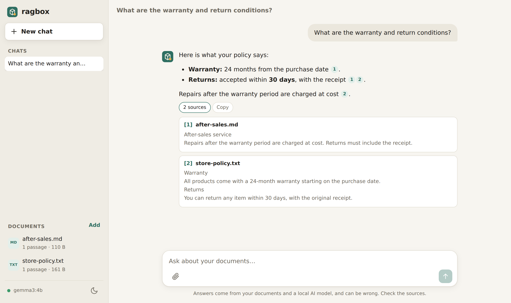
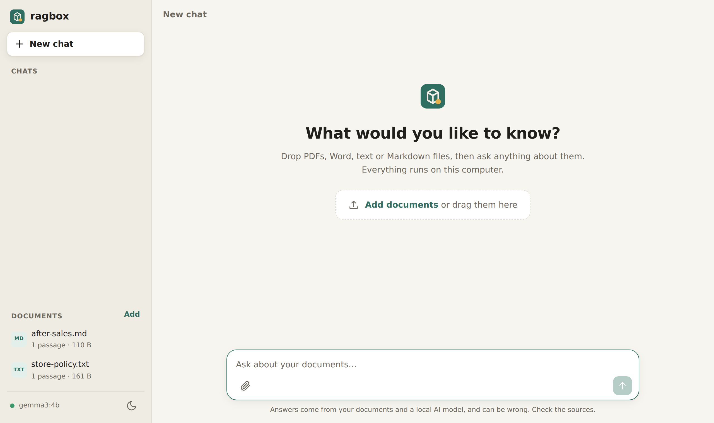
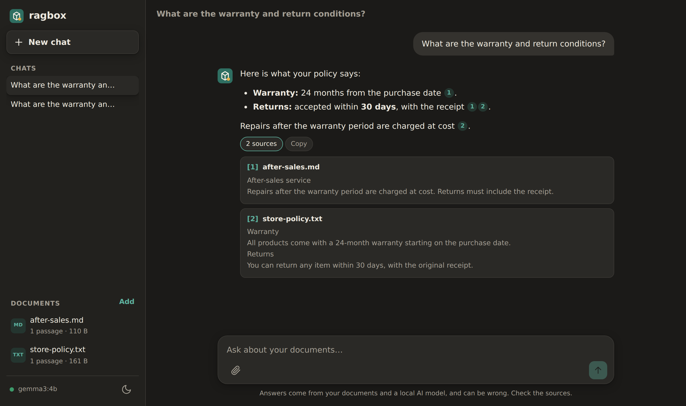

<p align="center">
  
</p>

<h1 align="center">ragbox</h1>

<p align="center">
  <b>Drop your files. Ask anything. 100% local.</b><br>
  The simplest way to chat with your documents — one command, no account, no API key, nothing leaves your computer.
</p>

<p align="center">
  <a href="https://github.com/Yahya-Younes/ragbox/actions/workflows/ci.yml"></a>
  
  
</p>

<p align="center">
  
</p>

## Quick start

You only need **[Docker](https://docs.docker.com/get-docker/)** (Docker Desktop on Windows and Mac).

```bash
git clone https://github.com/Yahya-Younes/ragbox.git
cd ragbox
docker compose up -d
```

Open **http://localhost:8080**, drop your files, and start asking questions. That's it.

> **First launch:** ragbox downloads the local AI models once (about 3.6 GB — a progress bar shows it in the app). After that, it starts in seconds and works offline.

To stop it: `docker compose down` — your documents and chats are kept. To delete everything: `docker compose down -v`.

## What you get

- 📄 **Drag and drop** PDF, Word (`.docx`), text and Markdown files — anywhere in the window.
- 💬 **Answers that stream** as they're written, in the language of your question.
- 🔎 **Clickable citations**: every claim links to the exact passage, file and page it comes from.
- 🧠 **Hybrid search**: meaning-based (vector) search combined with exact keyword search, so both "what's the refund policy?" and "SKU-4471" work.
- 🗂️ **Chat history** saved locally, duplicate files detected automatically, light and dark mode, works on mobile.
- 🔒 **Private by design**: the AI runs on your machine through [Ollama](https://ollama.com); the app is only reachable from your computer.

<p align="center">
  
  
</p>
<p align="center"><sub>Screenshots use demo documents.</sub></p>

## Requirements

| | Minimum | Recommended |
|---|---|---|
| Memory (RAM) | 8 GB | 16 GB |
| Free disk space | 10 GB | 15 GB |
| GPU | Not needed | NVIDIA GPU for much faster answers ([see below](#faster-answers-with-a-gpu)) |

## How it works

```
 your browser ──▶ ragbox app (FastAPI, port 8080, localhost only) ──▶ Ollama (local AI models)
                       │
                       └── SQLite file: documents, passages, vectors, keyword index, chats
```

1. **Ingest** — each file is read page by page, cleaned and split into overlapping passages.
2. **Embed** — every passage becomes a vector with a local embedding model (`nomic-embed-text`).
3. **Retrieve** — your question is searched by meaning (vectors) *and* by keywords (SQLite FTS5 / BM25); both rankings are merged with reciprocal rank fusion.
4. **Answer** — the best passages are given to a local chat model (`gemma3:4b`) with instructions to cite them, and the answer streams back to you.

Two containers, no external database, no cloud service.

## Configuration

Everything works out of the box. To customise, copy `.env.example` to `.env` and edit it, then run `docker compose up -d` again.

| Variable | Default | What it does |
|---|---|---|
| `RAGBOX_PORT` | `8080` | Port on your computer |
| `RAGBOX_CHAT_MODEL` | `gemma3:4b` | Any chat model from the [Ollama library](https://ollama.com/library) (e.g. `qwen3:8b`, `llama3.2:3b`) |
| `RAGBOX_EMBED_MODEL` | `nomic-embed-text` | Embedding model. Changing it requires re-adding your documents |
| `RAGBOX_MAX_UPLOAD_MB` | `50` | Largest file you can upload |
| `RAGBOX_OLLAMA_URL` | `http://ollama:11434` | Use another Ollama server (see below) |
| `RAGBOX_ALLOWED_HOSTS` | `localhost,127.0.0.1,[::1]` | Host names the app answers to |

### Faster answers with a GPU

On Linux or Windows (WSL2) with an NVIDIA GPU and the [NVIDIA Container Toolkit](https://docs.nvidia.com/datacenter/cloud-native/container-toolkit/install-guide.html):

```bash
docker compose -f compose.yaml -f compose.gpu.yaml up -d
```

### Mac users

Docker on macOS can't use the Apple GPU. For much faster answers, install the [Ollama app](https://ollama.com/download) natively, then put this line in `.env`:

```
RAGBOX_OLLAMA_URL=http://host.docker.internal:11434
```

## Security and privacy

- The app listens on **`127.0.0.1` only**: other machines on your network can't reach it. Ollama isn't exposed at all.
- **No telemetry, no external requests** from the web page (strict Content-Security-Policy, no CDN).
- Protection against **DNS rebinding** (host allow-list) and **cross-site requests** (a custom header is required for every change).
- Uploaded files are checked by content (not just extension), size-limited, stored under random names, and Word files are checked against decompression bombs.
- Document text is treated as **untrusted data** in the prompt, and the page escapes everything it displays.
- The app container runs as a **non-root user**, with a **read-only filesystem**, **no Linux capabilities** and memory/process limits.

See [SECURITY.md](SECURITY.md) to report a vulnerability.

## Troubleshooting

| Problem | Fix |
|---|---|
| "Starting the local AI engine…" for a long time | Run `docker compose logs ollama`. The first start can take a minute. |
| Model download failed | Check your internet connection, then click **Retry** in the banner. |
| A PDF shows "No text found" | It's a scanned image. ragbox doesn't do OCR yet. |
| Answers are slow | Use a GPU (see above), or a smaller model such as `RAGBOX_CHAT_MODEL=llama3.2:3b`. |
| Port 8080 is already used | Set `RAGBOX_PORT=8090` in `.env`. |

## Development

```bash
python -m venv .venv && source .venv/bin/activate
pip install -r requirements-dev.txt
pytest                      # unit + API tests (a fake Ollama is used, no model needed)
ruff check . && ruff format --check .
```

End-to-end test with the real containers and a fake model server:

```bash
docker compose -f compose.yaml -f tests/e2e/compose.e2e.yaml up -d --build
tests/e2e/run_e2e.sh
```

## Roadmap

- OCR for scanned PDFs
- More formats (HTML, PowerPoint, Excel)
- Collections: ask questions about a selected set of files
- Re-ranking model for even better retrieval

Contributions are welcome — open an issue to discuss an idea.

## License

[MIT](LICENSE)
